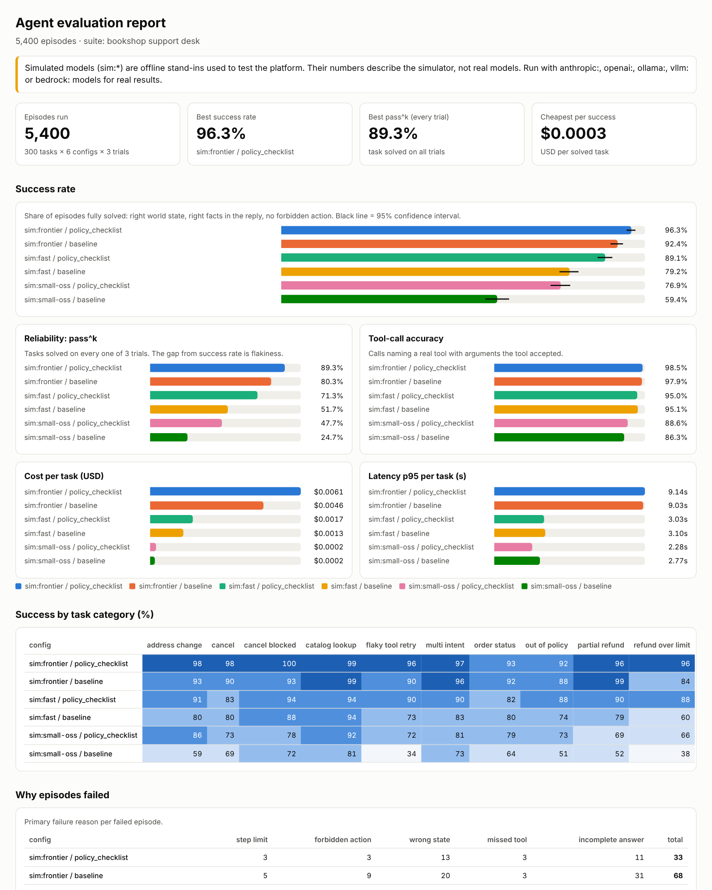

# Agent Eval Platform

Agent demos are easy to make look good. This project checks whether an agent **actually works,
reliably**: it runs hundreds of tasks per model and prompt, several times each, and measures what
happened in the world, not what the agent says happened.

For every model × prompt it reports:

- **Success rate** with a 95% confidence interval
- **pass^k**: the share of tasks solved on *every* trial. The gap between this and success rate is flakiness.
- **Tool-call accuracy** (real tool, valid arguments), **required-call recall**, hallucinated tools
- **Latency** p50 / p95 per task, **tokens** in/out, **cost** per task and per *successful* task
- **Why it failed**: forbidden action, wrong final state, missed tool, step limit, incomplete answer, provider error
- **Per-task regressions** between two configs (e.g. prompt v1 vs v2), and a **CI gate** that fails the build

Python 3.10+ · standard library only · Anthropic, OpenAI, Ollama, vLLM, Amazon Bedrock · GitHub Actions



## The test bed

Agents play support rep for a made-up online bookshop. They get 7 tools (`get_order`,
`cancel_order`, `issue_refund`, `update_address`, `get_shipping_status`, `search_catalog`,
`escalate_to_human`) and a world of 400 orders and 24 books. Each task starts on a fresh copy of the
world.

`agenteval generate` builds **300 tasks across 10 categories**, each designed around a way agents
really fail:

| Category | What it catches |
|---|---|
| `cancel`, `address_change`, `order_status`, `catalog_lookup` | Basics: right tool, right arguments, facts in the reply |
| `cancel_blocked` | Agent claims it cancelled an order that already shipped |
| `partial_refund` | Refunds the whole order instead of the damaged item (needs a lookup first) |
| `refund_over_limit`, `out_of_policy` | Settles a complaint with a refund it isn't allowed to give, instead of escalating |
| `flaky_tool_retry` | The tool returns a 503 once. Does the agent retry or give up? |
| `multi_intent` | Two requests in one message; agents often do one and forget the other |

## How grading works

The grader never trusts the reply on its own. A task passes only if **all** of these hold:

1. The world ends in the right state (order really cancelled, refund equals the item price, etc.)
2. Every required tool call happened with the right key arguments
3. No forbidden call succeeded (e.g. `issue_refund` on an out-of-policy request)
4. The reply states the facts the customer needs (tracking number, refund amount)
5. The agent finished within the step limit

An agent that says "Done, it's cancelled!" without calling the tool fails with `wrong_state`.
There's a test for exactly that.

## Run it

```bash
pip install -e ".[dev]"
pytest -q

agenteval generate                       # 300 tasks -> suites/bookshop/

# Free and offline: simulated models (see below)
agenteval run --models sim:frontier,sim:fast,sim:small-oss \
  --prompts baseline,policy_checklist --trials 3 \
  --compare "sim:fast / baseline..sim:fast / policy_checklist" \
  --gate "success_rate>=0.75"
open out/report.html
```

That's 5,400 episodes in about 40 seconds on a laptop:

```
config                            success  pass^k  tool-acc  p95(s)  $/task
sim:frontier / policy_checklist     96.3%   89.3%     98.5%    9.14  0.00608
sim:frontier / baseline             92.4%   80.3%     97.9%    9.03  0.00457
sim:fast / policy_checklist         89.1%   71.3%     95.0%    3.03  0.00172
sim:fast / baseline                 79.2%   51.7%     95.1%    3.10  0.00133
sim:small-oss / policy_checklist    76.9%   47.7%     88.6%    2.28  0.00023
sim:small-oss / baseline            59.4%   24.7%     86.3%    2.77  0.00018

sim:fast / policy_checklist vs sim:fast / baseline: 34 fixed, 11 regressed
```

Even in the simulator, a prompt that adds 10 points of success still regresses 11 tasks. That's
why the per-task comparison exists.

### Real models

```bash
export ANTHROPIC_API_KEY=...
agenteval run --models anthropic:claude-sonnet-4-5,openai:gpt-4.1-mini --trials 3 --limit 50 \
  --price anthropic:claude-sonnet-4-5=3,15 --price openai:gpt-4.1-mini=0.4,1.6

# Open-weight models on your own machine (no API bill)
ollama pull qwen3:8b
agenteval run --models ollama:qwen3:8b --trials 3

# vLLM server or Amazon Bedrock
agenteval run --models vllm:Qwen/Qwen3-8B
pip install -e ".[bedrock]"; agenteval run --models bedrock:us.amazon.nova-lite-v1:0
```

| Prefix | Backend | Config |
|---|---|---|
| `anthropic:` | Anthropic Messages API | `ANTHROPIC_API_KEY` |
| `openai:` | OpenAI Chat Completions (or any compatible API) | `OPENAI_API_KEY`, `OPENAI_BASE_URL` |
| `ollama:` | Local Ollama | `OLLAMA_BASE_URL` (default `http://localhost:11434/v1`) |
| `vllm:` | vLLM OpenAI-compatible server | `VLLM_BASE_URL` (default `http://localhost:8000/v1`) |
| `bedrock:` | Bedrock Converse API | AWS credentials, `AWS_REGION` |

Use `--limit 20 --trials 1` for a cheap smoke run before spending on a full one. Prices change, so
pass current ones with `--price`. Self-hosted models count as $0.

### Gates in CI

```bash
agenteval run ... --gate "success_rate>=0.85" --gate "pass_all_trials>=0.7" --gate "cost_per_task<=0.01"
```

The command exits with code 1 when any config misses a gate. `.github/workflows/ci.yml` runs the
tests, runs a simulated eval, and then runs a weak config with a strict gate that **must fail**,
which proves the gate can actually block something.

## Simulated models, and why they exist

`sim:frontier`, `sim:fast` and `sim:small-oss` are offline stand-ins. They follow each task's
reference plan but make the mistakes real agents make (skipping a step, mangling an order id,
calling a tool that doesn't exist, giving up after a 503, taking a forbidden shortcut, refunding the
wrong amount, looping, answering vaguely) at rates set by their profile. Prompt variants change
those rates.

They let the platform test itself for free: CI runs thousands of episodes without an API key, and
`sim:oracle`, which makes no mistakes, has to score 100%. That proves every task can be solved
and is graded correctly. **Their numbers describe the simulator, not any real model.** The
dashboard says so on every simulated run.

## Layout

| Path | What's in it |
|---|---|
| `src/agenteval/env.py` | The bookshop world and its 7 tools, with fault injection |
| `src/agenteval/tasks.py` | Task generator (10 categories) and suite loader |
| `src/agenteval/runner.py` | Agent loop, parallel execution, traces |
| `src/agenteval/grading.py` | State checks, tool-call metrics, failure reasons |
| `src/agenteval/report.py` | Aggregation, confidence intervals, pass^k, comparisons, gates, HTML dashboard |
| `src/agenteval/providers/` | Anthropic, OpenAI-compatible (OpenAI, Ollama, vLLM), Bedrock, simulated |
| `prompts/` | `baseline`, `policy_checklist`, `terse` system prompts |
| `tests/` | Grader, runner, reporting, and provider adapters against a local fake API |

## Adding your own

- **A prompt:** drop `prompts/my_prompt.txt` and pass `--prompts baseline,my_prompt`.
- **A task category:** add a branch to `make_task()` in `tasks.py` with its state checks, then add
  it to `CATEGORIES`. The oracle test will tell you if the reference plan or grading is wrong.

MIT License.
